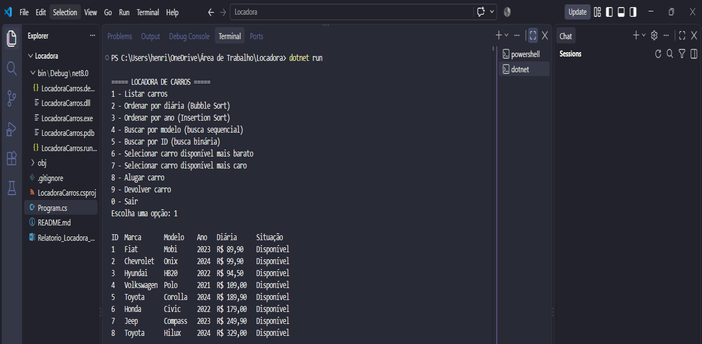

# Locadora de Carros - TED de Estruturas de Dados (Grupo 5)

Trabalho acadêmico do **2º bimestre de Sistemas de Informação**, UNISAPIENS, orientado pela professora **Rosângela**.

O relatório original do grupo foi mantido **sem alterações**, conforme a versão enviada para a preparação da entrega.

**Integrantes identificados na versão recebida do relatório:**
- Carlos Henrique Farias dos Santos
- Andesson Albano
- Elias de Souza


## Objetivo

Demonstrar o uso de uma estrutura de dados **linear (`List<Carro>`)** e de **dois critérios para cada categoria**: ordenação, busca e seleção, num programa simples de locadora em C#.

O sistema permite consultar a frota, localizar veículos, comparar preços, alugar e devolver carros. É uma simulação didática de console; **os dados ficam apenas na memória enquanto o programa está aberto**.

## Funcionalidades e algoritmos

| Menu | Recurso | Técnica aplicada |
|---|---|---|
| 1 | Listar os carros cadastrados | Percurso da lista |
| 2 | Exibir veículos por diária crescente | Bubble Sort (em uma cópia) |
| 3 | Exibir veículos por ano crescente | Insertion Sort (em uma cópia) |
| 4 | Encontrar veículos por parte do modelo | Busca sequencial, sem distinguir maiúsculas |
| 5 | Encontrar veículo pelo ID | Busca binária |
| 6 | Encontrar o disponível mais barato | Seleção do menor valor |
| 7 | Encontrar o disponível mais caro | Seleção do maior valor |
| 8 | Alugar um carro por um número de dias | Busca binária, validação e cálculo do total |
| 9 | Devolver um carro | Busca binária e atualização da disponibilidade |
| 0 | Encerrar | Fim da aplicação |

A lista original **permanece ordenada por ID**: as duas rotinas de ordenação trabalham sobre cópias. Isso preserva a condição necessária à busca binária.

## Requisitos

- **.NET SDK 8.0** (não basta ter apenas o runtime).
- Terminal com suporte a UTF-8 ou Visual Studio/VS Code.

## Como executar

Abra um terminal na pasta que contém `LocadoraCarros.csproj` e execute:

```bash
dotnet restore
dotnet run --project LocadoraCarros.csproj
```

No Visual Studio, abra o arquivo `.csproj` e inicie o projeto. O programa já começa com oito carros cadastrados, para permitir testar todas as opções sem configuração adicional.

## Exemplo de utilização

1. Digite `1` para conferir a frota e identificar os IDs.
2. Digite `2` e `3` para comparar as duas ordenações.
3. Digite `4` e procure `HB20`; depois use `5` para pesquisar pelo ID `4`.
4. Digite `6` e `7` para comparar os extremos entre os disponíveis.
5. Digite `8`, informe o ID `5`, um nome e `15` dias. O total esperado para o Toyota Corolla é **R$ 2.848,50** (`189,90 × 15`).
6. Tente alugar o mesmo carro novamente: o programa deve informar que ele já está alugado.
7. Use `9`, devolva o carro `5` e confirme que ele volta a ficar disponível.



## Documentação e evidências

- [Relatório original do grupo em PDF](docs/Relatorio_Locadora_de_Carros.pdf) — documento original de 8 páginas, preservado integralmente.
- [Roteiro de testes e cenários esperados](docs/ROTEIRO_DE_TESTES.md).
- [Capturas de tela utilizadas no relatório](docs/capturas/).

## Organização do projeto

```text
Locadora_Grupo5/
├── LocadoraCarros.csproj
├── Program.cs
├── .gitignore
├── README.md
└── docs/
    ├── Relatorio_Locadora_de_Carros.pdf
    ├── ROTEIRO_DE_TESTES.md
    └── capturas/
```

## Verificação da compilação

O repositório inclui um fluxo do GitHub Actions em `.github/workflows/build.yml`, que tenta compilar automaticamente o projeto com .NET 8 após cada envio. Consulte a guia **Actions** do repositório e confirme o resultado antes da entrega.

## Limitações e possíveis melhorias

O programa é uma demonstração para a disciplina: não possui banco de dados, datas reais de retirada/devolução, cálculo de multas ou salvamento permanente. Uma versão futura poderia adicionar esses recursos sem substituir a lista linear usada para demonstrar os algoritmos.

## Entrega

O repositório deve ser **público**, contendo o código, o `README.md`, o relatório e as evidências. Apenas um representante envia o link à professora, com o nome de todos os integrantes.
